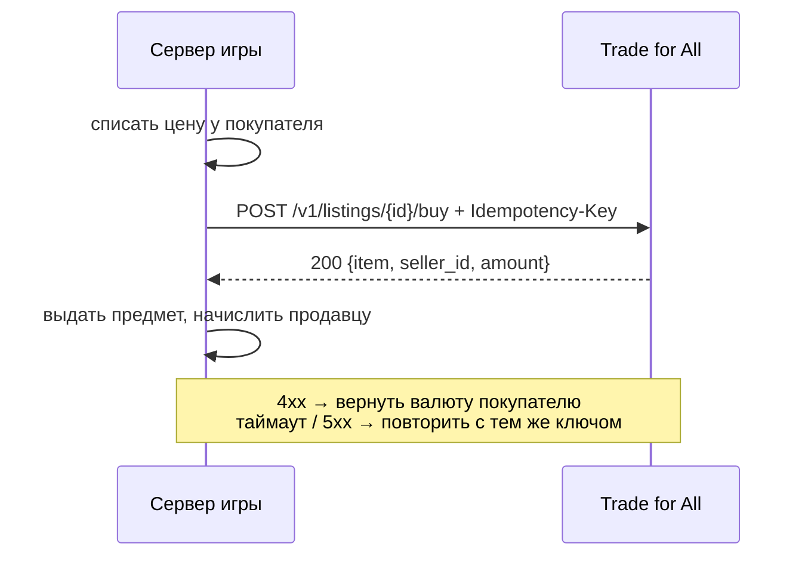

# Trade for All

Торговая площадка для онлайн-игр вне Steam, сделанная как REST API. Инди-студия подключает сервис к своему игровому серверу и получает готовый рынок, где игроки торгуют друг с другом: выставить предмет, купить, снять с продажи, изменить цену. Торговля идёт только за внутриигровую валюту, реальных денег нет.

**Go 1.25 · PostgreSQL 17 · Docker Compose**

## Зачем

У игр с itch.io, VK Play и собственных лаунчеров нет встроенного рынка. Игроки торгуются в Discord, и тот, кто отдаёт предмет первым, рискует остаться ни с чем. Маленькой студии долго писать свою площадку, а ошибка в ней легко приводит к дюпу, то есть к размножению предметов или валюты.

## Как это работает

```
клиент игры → сервер игры → Trade for All
```

Инвентари и балансы игроков хранит сервер игры, Trade for All их не хранит. API-ключ есть только у сервера игры, клиент игрока к сервису не обращается. Когда игрок выставляет предмет, сервер игры забирает его из инвентаря, и пока лот активен, предмет существует только в лоте (эскроу).

Так проходит покупка:



## Технические решения

- **Лот продаётся ровно один раз.** Каждая изменяющая операция выполняется в транзакции с `SELECT … FOR UPDATE`, а бизнес-правила проверяются после блокировки. Проверка вручную: 20 одновременных покупок одного лота дали один ответ `200` и девятнадцать `409 listing_not_active`.
- **Идемпотентность.** Каждый `POST`/`PATCH` требует заголовок `Idempotency-Key`. Результат сохраняется в той же транзакции, что и сама операция, поэтому повтор после таймаута получает исходный ответ и не выполняет операцию второй раз. Если тот же ключ пришёл с другим телом, сервис отвечает `422`. Два одновременных запроса с одним ключом тоже обрабатываются корректно.
- **Защита от смены цены.** Покупатель передаёт цену, которую видел. Если продавец успел её изменить, сервис отвечает `409 price_mismatch`, поэтому у покупателя списывается ровно та сумма, которую получит продавец.
- **Изоляция игр.** Сервис определяет игру по `X-API-Key`, и все данные разделены по `game_id`. Лот другой игры для клиента выглядит как `404`.
- **Курсорная пагинация** витрины: лоты не пропускаются и не дублируются, даже если между запросами появились новые.
- **Слои** `domain → repository → service → server`. Интерфейсы объявлены там, где их используют, а unit-тесты работают на фейках без базы.
- **12-factor:** конфиг берётся из env, логи пишутся в stdout в JSON (`log/slog`), миграции запускаются отдельным one-shot контейнером. По SIGTERM сервис корректно завершает работу, для проверок есть `/healthz` и `/readyz`.
- **Минимум зависимостей:** роутинг на стандартном `net/http` (паттерны Go 1.22+), единственная внешняя библиотека — `pgx`.

## Быстрый старт

Нужен Docker.

```bash
cp .env.example .env
docker compose up --build      # postgres → migrate → app
```

- **http://localhost:8080** — демо-фронтенд. Выберите игру и имя игрока, во второй вкладке войдите другим игроком и купите у первого. Кнопка «Повторить запрос» отправляет последний запрос с тем же `Idempotency-Key`, так можно проверить идемпотентность руками.
- **API:**
  ```bash
  curl -H "X-API-Key: demo-survival-key" localhost:8080/v1/listings
  ```
  Тестовые ключи `demo-survival-key` и `demo-rpg-key`. Миграции заранее создают в обеих играх по несколько лотов.

Тесты (база не нужна):

```bash
go test ./...
```

## API

| Метод | Путь | Что делает |
|---|---|---|
| `GET` | `/v1/listings?item_code=&seller_id=&limit=&cursor=` | витрина активных лотов |
| `POST` | `/v1/listings` | выставить лот |
| `PATCH` | `/v1/listings/{id}` | изменить цену |
| `POST` | `/v1/listings/{id}/buy` | купить |
| `POST` | `/v1/listings/{id}/cancel` | снять с продажи |
| `GET` | `/healthz`, `/readyz` | liveness / readiness |

Ошибки всегда приходят в виде `{"error": {"code", "message"}}` с понятными кодами (`listing_not_active`, `own_listing`, `price_mismatch`, …). Полная спецификация с примерами и инструкцией для сервера игры лежит в [docs/api.md](docs/api.md).

## Структура

```
cmd/trade/          точка входа, graceful shutdown
internal/domain     сущности и бизнес-правила, без зависимостей
internal/repository Postgres (pgx): транзакции и блокировки
internal/service    валидация, идемпотентность, оркестрация
internal/server     HTTP: роуты, middleware, маппинг ошибок
internal/web        фронтенд: один HTML на чистом JS, встроен через go:embed
migrations/         схема и демо-данные (golang-migrate)
```

## Планы

- Нагрузочный тест под целевые метрики: p95 < 200 мс при 100 RPS, ни одного дюпа на 1000 параллельных сделок
- Интеграционные тесты репозитория на реальном Postgres
- Очистка старых ключей идемпотентности по TTL
- Регистрация игр и выдача API-ключей через API, в базе хранится только хэш ключа
- Обмен предметами между игроками 1-на-1 и SDK для Unity
